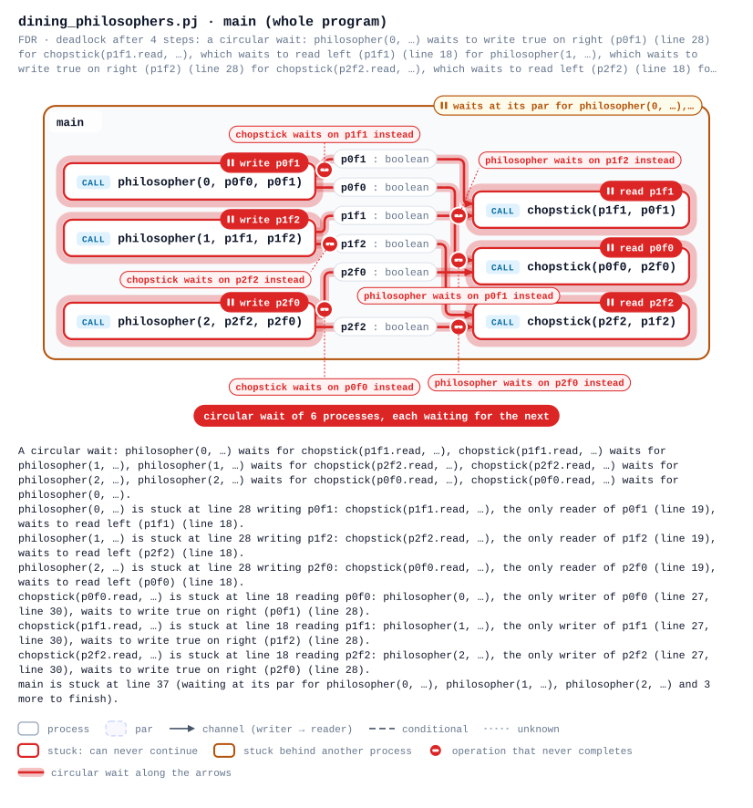
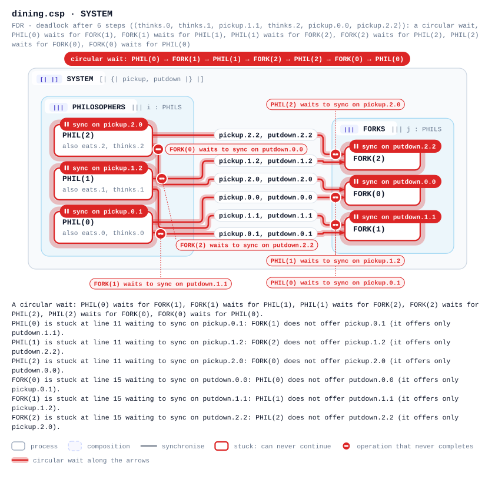

# processj-lsp

A language server for [ProcessJ](https://github.com/mattunlv/ProcessJ) with one-command setup for Neovim, VS Code and Emacs.

[](https://github.com/arianizadi/processj-lsp/actions/workflows/ci.yml)

Errors as you type, a type checker that knows channels, records, protocols and `par`, causal deadlock explanations, a zoomable process-network graph, formatting, rename, go to definition, completion with auto-imports, **▶ Run** from the editor, and **Convert to CSP / Check with FDR**: FDR's verdict on your program, with the stuck statements marked ("this write waits forever: consume, the only reader of a, has already terminated") and drawn on the graph.

## Install

You need [Node.js](https://nodejs.org) 20+ (with `npm`). For compiler diagnostics and ▶ Run you also need a JDK and a ProcessJ checkout, with `installdir=/path/to/ProcessJ` in `~/processjrc`; for Check with FDR, [FDR4](https://cocotec.io/fdr/) (found in the usual places, or set `fdrPath`). Everything else works without them.

```sh
git clone https://github.com/arianizadi/processj-lsp
cd processj-lsp
npm run setup -- nvim      # Neovim 0.11+ (lazy.nvim, AstroNvim, LazyVim, or plain Neovim)
npm run setup -- vscode    # VS Code (needs the `code` command on PATH)
npm run setup -- emacs     # Emacs 29+ (built-in eglot) or lsp-mode
npm run setup              # every editor found on this machine
```

Restart the editor and open a `.pj` file. The first run builds the server; editors are pointed at this checkout, nothing is copied.

## Update

```sh
git pull && npm run setup
```

## Uninstall

```sh
npm run remove -- nvim
npm run remove -- vscode
npm run remove -- emacs
npm run remove             # all three
```

Neovim: deletes `lua/plugins/processj.lua` (lazy.nvim) or the `pack/processj` link. VS Code: uninstalls the extension. Emacs: removes the marked block from your init file.

## Using it

| action | Neovim | VS Code | Emacs (eglot) |
| --- | --- | --- | --- |
| hover, go to definition | `K`, `gd` | hover, F12 | `C-h .`, `M-.` |
| quick fix / refactor | `<Leader>la` or `:lua vim.lsp.buf.code_action()` | Ctrl+. | `M-x eglot-code-actions` |
| rename | `<Leader>lr` or `:lua vim.lsp.buf.rename()` | F2 | `M-x eglot-rename` |
| format | `<Leader>lf` or `:lua vim.lsp.buf.format()` | Shift+Alt+F | `M-x eglot-format` |
| ▶ Run / Build | `:ProcessJRun`, `:ProcessJBuild` | play button, **ProcessJ: Run Current File** | `M-x eglot-execute-command processj.run` |
| concurrency graph: the process network, and where it gets stuck | `:ProcessJGraph` (opens your browser; `markdown`, `svg`, `excalidraw` for the other forms) | **ProcessJ: Show Concurrency Graph**, or the **Concurrency graph** lens | `C-c C-g` (`M-x processj-show-graph`) |
| export the graph as SVG, Excalidraw, HTML or JSON | `:ProcessJGraphExport [format] [dir]` | **ProcessJ: Export Concurrency Graph** | `C-c C-e` (`M-x processj-export-graph`) |
| effects, protocols | `:ProcessJEffects`, `:ProcessJProtocols` | **ProcessJ: Show …** commands | code lenses are not shown by eglot; use the VS Code or Neovim commands |
| convert to CSP (`file.csp` next to the file) | `:ProcessJCsp [procedure]` | **ProcessJ: Convert to CSP** | `M-x processj-convert-to-csp` |
| check with FDR (the graph opens on the result, with stuck statements marked; diagnostics; a step-by-step report) | `:ProcessJFdr [procedure]` or the **FDR: check & show graph** lens; `:ProcessJFdrCancel` stops it | **ProcessJ: Check with FDR** or the lens; **Cancel** on its notification | `C-c C-f` (`M-x processj-check-with-fdr`); `M-x processj-cancel-fdr` |
| a CSPm file (`.csp`, hand-written or from Convert to CSP): its process network | `:ProcessJGraph` in the `.csp` buffer | **ProcessJ: Show Concurrency Graph** (language **CSPm**) | `C-c C-g` in `cspm-mode` |
| a CSPm file: FDR on its own `assert` lines, shown on that network | `:ProcessJFdr` in the `.csp` buffer, or the **FDR: check & show graph** lens on an `assert` | **ProcessJ: Check with FDR** | `C-c C-f` in `cspm-mode` |

If a `.pj` file opens with no diagnostics at all, run `:checkhealth processj-lsp` in Neovim, open the ProcessJ language-status menu in VS Code, or check `*EGLOT events*` in Emacs. The server speaks standard LSP over stdio (`node bin/processj-lsp.js --stdio`, language id `processj`; `cspm` or `csp` for CSPm), so any other editor can use it too. A `.csp` file gets no ProcessJ analysis: only the graph, FDR, its own syntax and type errors and its outline. With lazy.nvim, load the plugin for both filetypes (`ft = { "processj", "csp" }`; `npm run setup -- nvim` writes that).

## See where FDR finds a deadlock

Check with FDR, and when a check fails the graph opens on what FDR found (in your browser, or VS Code's panel):

| | Neovim | VS Code | Emacs (eglot) |
| --- | --- | --- | --- |
| check, then see the result | `:ProcessJFdr [procedure]` | **ProcessJ: Check with FDR** | `C-c C-f` |
| the graph on a result again | the verdict lens (`FDR: deadlock (4 steps)`) | the verdict lens | `C-c C-g` |
| a stuck statement: why, and where in the graph | `K`; **Show in graph** from `<Leader>la` | hover; **Show in graph** from Ctrl+. | `C-h .`; **Show in graph** from `M-x eglot-code-actions` |



That is [`examples/dining_philosophers.pj`](examples/dining_philosophers.pj): every philosopher picks up its left chopstick first. FDR finds the run where all three hold one: red boxes can never continue, each red arrow ends in a stop marker at the operation that waits forever, the reason sits beside it, and the band marks the circle of six processes, each waiting for the next. The static checker cannot see this one (no statement is stuck in every run), which is what FDR is for. In the viewer the panel tells it cause first (the circle, then who is in it), the timeline replays the four steps that lead there, the sequence chart draws them, and double-clicking a box opens its state machine: one state per place the process can wait (the definitions FDR's answer names), the states this run went through numbered in order, and the one it is stuck in (a process stuck inside a call is on that call's arrow, and the call opens the callee's machine). A run that relies on what the model abstracts (an alt taking its skip guard, a timeout ending early, an abstract value) says so on the page, with what the real program would need for it, and a proof the compiled program may not share says so on its chip and lens. [`dining_philosophers_fixed.pj`](examples/dining_philosophers_fixed.pj) breaks the circle, and FDR finds no deadlock. `fdrShowGraph` sets when the graph opens by itself (`always`, the default; `onFailure`; `never`).

A network whose shape depends on arguments is worked out before FDR sees it: an array of channels (`new chan<int>[size - 1]`, with `size` known where the procedure is called) becomes one channel per element, and a procedure that calls itself through a `par` with arguments that stop it unfolds into one stage per call. [`test/fixtures/fifo/blocks.pj`](test/fixtures/fifo/blocks.pj) builds two six-stage FIFOs that way: FDR finds them deadlock-free and terminating, and the graph draws `chans[0]` to `chans[4]` between the stages and the recursive one as nested stages. What cannot be worked out (a length or a recursion only the run decides) is reported as not modelled, and nothing is checked.

## Graphs of CSPm files

Open a `.csp` file and the same graph draws its network: the operands of each parallel composition are boxes, and the events two of them must share are a link between them (an arrow from the one that only outputs `!` to the one that only inputs `?`, a plain line for a synchronisation, a hub when three or more take part, a port for the environment, and a dashed end for an event the composition synchronises on that its other side never performs). FDR then checks the file's own assertions and the result lands on that drawing: here [`test/fixtures/cspm/dining.csp`](test/fixtures/cspm/dining.csp), the dining philosophers written by hand, where every philosopher holds its left fork and waits for its right one.



A model Convert to CSP generated is a CSPm file too: its boxes show the ProcessJ line each process stands for, and the page links back to the `.pj` file. [docs/DETAILS.md](docs/DETAILS.md#graphs-and-fdr-for-csp-files) lists what of CSPm is understood and what is not.

## More

[docs/DETAILS.md](docs/DETAILS.md) covers every diagnostic, how the analysis works, the CSP model FDR checks and how its answers are explained, the options, performance numbers and development (`npm test`, `npm run smoke`, `npm run bench`).

The same server also runs in a browser, as a Web Worker (`npm run build:browser`), with the compiler and FDR on a runner service: see [the browser build](docs/DETAILS.md#the-browser-build).

## License

Apache-2.0. See [LICENSE](LICENSE) and [NOTICE](NOTICE).
